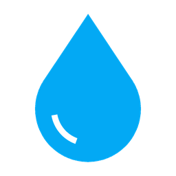

# Water Reminder for Home Assistant

## TL;DR

Every N minutes a push notification asks you to drink some water. Pause it from the
notification, keep it quiet at night or during a Focus. Set up entirely in the UI, no YAML.

## Features

- **Interval** adjustable (default 30 min), aligned to the clock (e.g. hh:00 and hh:30).
- **One or more targets** with the Home Assistant Companion app.
- **Water drop image** in every reminder (thumbnail or big picture, depending on the device), served by the
  integration itself at `/water_reminder/notification.png` – no external image host.
- **Disappears by itself** after 60 s (configurable, 0 = keep); a new reminder replaces the old one.
- **Quiet** while the alarm panel is in selected states (default `armed_night`) or the
  *Quiet (Focus)* switch is on.
- **Actions in the notification:** `OK`, `Pause for 1 h`, `Pause for 3 h`, `Pause for today`.
  The same as buttons in HA, plus *Resume* and *Send test*.

## Installation

1. **Settings → Marketplace** → add this repository by its link
   (`https://github.com/NoSpoonLabs/HomeAssistant-Water-Reminder`) and install *Water Reminder*.
2. **Settings → Devices & services → Add integration → Water Reminder**.
3. Pick one or more `notify.mobile_app_…` services and, optionally, your alarm panel.

Updates need a Home Assistant restart. Targets, alarm panel, quiet states, removal delay and
texts can be changed later via **Configure** on the integration.

## Entities

| Entity | Purpose |
| --- | --- |
| `switch.water_reminder` | Reminder on/off |
| `switch.water_reminder_quiet_focus` | Suppress reminders (set by iOS Shortcuts) |
| `number.water_reminder_interval` | Interval in minutes |
| `sensor.water_reminder_status` | `active`, `paused`, `quiet_alarm`, `quiet_focus`, `off` |
| `sensor.water_reminder_next_reminder` | Time of the next reminder |
| `sensor.water_reminder_paused_until` | End of the current pause |
| `button.water_reminder_send_test` | Send a reminder now (respects off / pause / quiet) |
| `button.water_reminder_pause_1_h` / `_3_h` / `_today` / `resume` | Pause / resume |

## Focus modes (iOS)

Home Assistant only knows *whether* a Focus is on, not *which*. Per Focus, create an iOS
Shortcuts personal automation on each device:

1. Shortcuts → Automation → **New** → **Focus** → choose a Focus → *When turning on* → *Run immediately*.
2. Action: Home Assistant → **Control switch** → `switch.water_reminder_quiet_focus` → *On*.
3. Repeat with *When turning off* → *Off*.

## Known limitation

`clear_notification` is unreliable on some iOS Companion versions
([home-assistant/iOS#4304](https://github.com/home-assistant/iOS/issues/4304)).
If a reminder stays, the next one replaces it.

## Development

See [DEVELOPERS.md](DEVELOPERS.md).
